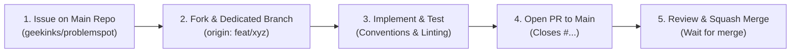

# Contributing to ProblemSpot

Thank you for your interest in contributing to **ProblemSpot**! We want to make it easier for people to report real-world problems, help communities validate them, and collaborate on practical solutions.

Every contribution matters—whether you report a problem, improve documentation, review evidence, design an accessible interface, fix a bug, or build a feature.

Please read this guide before opening an issue or pull request.

## Table of Contents

- [Our Principles](#our-principles)
- [Ways to Contribute](#ways-to-contribute)
- [Before You Start](#before-you-start)
- [Development Setup](#development-setup)
- [Contribution Workflow](#contribution-workflow)
- [Code and Documentation Guidelines](#code-and-documentation-guidelines)
- [Testing and Quality Checks](#testing-and-quality-checks)
- [AI and Community Validation](#ai-and-community-validation)
- [Security and Privacy](#security-and-privacy)
- [Issues and Pull Requests](#issues-and-pull-requests)
- [Community Expectations](#community-expectations)

## Our Principles

ProblemSpot is built around these principles:

1. **Community first:** Build for the people experiencing a problem, not just for the people building the software.
2. **Evidence over assumptions:** Make it easy to provide context and supporting evidence without requiring people to expose private information.
3. **Human validation:** Community support is a signal, not automatic proof that a problem is verified.
4. **Inclusive participation:** Contributions from people with different skill levels, backgrounds, and abilities are welcome.
5. **Transparency:** Explain important status changes, AI-assisted decisions, and moderation actions clearly.
6. **Privacy and safety:** Collect only the information needed and handle sensitive reports responsibly.
7. **Open collaboration:** Prefer clear documentation, reviewable changes, and constructive discussion.

## Ways to Contribute

You do not need to be a software developer to contribute.

- **Product and research:** Identify user needs, improve workflows, and help define useful validation criteria.
- **Problem discovery:** Submit a clear description of a real community problem.
- **Community validation:** Confirm that you experience a problem, support addressing it, or provide relevant evidence.
- **Design and accessibility:** Improve usability, responsive layouts, accessibility, and user research.
- **Frontend and backend development:** Build features, fix bugs, and improve performance.
- **AI and data:** Improve categorization, summarization, duplicate suggestions, evaluation datasets, and model integration.
- **Documentation:** Improve setup instructions, guides, API documentation, and examples.
- **Testing and quality assurance:** Reproduce bugs, write tests, and test edge cases.
- **Community support:** Help newcomers, review issues, and provide constructive feedback.

If you are new to the project, look for issues marked `good first issue` or `help wanted` if those labels are available.

## Before You Start

1. Read the project [README](README.md) to understand the product and setup.
2. Review [`docs/ARCHITECTURE.md`](docs/ARCHITECTURE.md) before changing application structure, database design, or AI integration.
3. Search existing issues and pull requests to avoid duplicating work.
4. For a significant feature or architectural change, open an issue first so the approach can be discussed.
5. Never publish secrets, private user information, or real-world evidence that you do not have permission to share.

If you are unsure whether an idea fits the project, open an issue with the problem you are trying to solve and your proposed approach.

## Development Setup

ProblemSpot is planned around a modular Next.js application with TypeScript and Supabase. AI inference is designed to sit behind a separate, configurable service; the application should not depend on a specific inference device being available during ordinary development.

### Prerequisites

Install the versions supported by the repository and have access to:

- Git
- Node.js and the package manager used by the repository
- A Supabase project or local Supabase development environment, where needed
- The repository's environment variables for the features you are testing

### Get the code

Fork the repository on GitHub ([`geekinks/problemspot`](https://github.com/geekinks/problemspot)), then clone your personal fork:

```bash
git clone https://github.com/<your-username>/problemspot.git
cd problemspot
```

Configure the upstream remote pointing to the main organization repository:

```bash
git remote add upstream https://github.com/geekinks/problemspot.git
```

Verify your remotes:
- `origin` points to your personal fork (`https://github.com/<your-username>/problemspot.git`)
- `upstream` points to the primary repository (`https://github.com/geekinks/problemspot.git`)

### Install dependencies

Use the package manager indicated by the lockfile in the repository. For example:

```bash
npm install
```

If the repository uses `pnpm-lock.yaml`, `yarn.lock`, or another lockfile, use that package manager instead. Avoid committing changes to a lockfile produced by a different package manager.

### Configure environment variables

Create a local environment file using the variable names documented in `README.md` and the relevant example environment file, if one exists. Common variables may include:

```dotenv
NEXT_PUBLIC_SUPABASE_URL=
NEXT_PUBLIC_SUPABASE_PUBLISHABLE_KEY=
SUPABASE_SERVICE_ROLE_KEY=
GEMMA_BASE_URL=
GEMMA_API_TOKEN=
```

Only configure variables required for the feature you are working on. Use local or development credentials, never production credentials.

**Security requirements:**

- Never commit `.env`, `.env.local`, access tokens, private keys, or service credentials.
- Keep `SUPABASE_SERVICE_ROLE_KEY` and AI service tokens on the server only.
- Variables prefixed with `NEXT_PUBLIC_` are exposed to the browser; never put secrets in them.
- Do not disable Row Level Security (RLS) as a shortcut to make a feature work.

### Start the development server

Use the development command defined in the repository's `package.json`. For a standard Next.js setup, it is commonly:

```bash
npm run dev
```

Follow the README and existing project scripts if they differ from these examples.

## Mandatory Contribution Workflow

All contributors (including maintainers and automated pair-programming agents) must follow this strict 5-step lifecycle. **Direct commits or pushes to `main` are strictly prohibited.**



### 1. Check Existing Issues or Open a New Issue
- **All issues must be opened on the upstream repository:** [`geekinks/problemspot/issues`](https://github.com/geekinks/problemspot/issues).
- Before writing any code, search open issues with `gh issue list --repo geekinks/problemspot`.
- If no issue covers your proposed work, open one with `gh issue create --repo geekinks/problemspot` to align on requirements, user problem, and technical approach.
- **Unsolicited PRs without an associated issue will not be reviewed.**

### 2. Fork the Repository and Create a Dedicated Branch
- If you haven't already, fork the repository using the GitHub CLI or web UI:
  ```bash
  gh repo fork geekinks/problemspot --clone=false --remote=true
  ```
- Always sync your local default branch (`main`) with `upstream/main` before creating a new branch:
  ```bash
  git checkout main
  git pull upstream main
  git checkout -b <type>/<kebab-case-description>
  ```
- **Branch naming conventions:**
  - `feat/` — new user-facing functionality or enhancement
  - `fix/` — bug fixes
  - `docs/` — documentation, guides, or specifications
  - `design/` — design system tokens, wireframes, or UI assets
  - `test/` — automated unit, integration, or e2e tests
  - `refactor/` — internal code quality improvements without behavioral changes
  - `chore/` — maintenance, tooling, dependencies, and configuration
- Keep each branch focused on one logical issue. Never commit directly to `main`.

### 3. Make and Verify Your Changes Locally
- Adhere to [`brand.md`](brand.md) visual standards and [`docs/ARCHITECTURE.md`](docs/ARCHITECTURE.md) design boundaries.
- Follow TypeScript strict typing; avoid `any`.
- Run static analysis, linting, and tests locally before committing. Ensure 0 errors and all tests pass:
  ```bash
  npm run lint
  npm test
  ```
- Commit using Conventional Commits with clear scope:
  ```text
  feat(problems): implement problem submission wizard with category select
  fix(voting): prevent duplicate personal confirmation entries
  docs(contributing): formalize fork and PR contribution workflow
  test(auth): add RLS policy verification tests
  ```

### 4. Push to Fork and Open a Pull Request
- Push your dedicated branch to your personal fork (`origin`):
  ```bash
  git push -u origin <type>/<kebab-case-description>
  ```
- Open a Pull Request targeting `geekinks/problemspot:main` referencing the issue:
  ```bash
  gh pr create --repo geekinks/problemspot --title "<type>(<scope>): <summary>" --body "Closes #<issue_number>"
  ```
- Complete the PR description detailing the problem solved, testing performed, and UI screenshots/recordings if applicable.

### 5. Review, CI Verification, and Squash Merge
- **Do not merge directly.** Wait for automated CI checks and maintainer review.
- Respond constructively to review feedback and push adjustments to your branch as needed.
- Once approved and CI passes, maintainers will squash-merge the PR into `main` and delete the remote branch.
- After merge, switch back to `main`, sync locally, and clean up your feature branch:
  ```bash
  git checkout main
  git pull upstream main
  git branch -d <type>/<kebab-case-description>
  ```

## Code and Documentation Guidelines

### General

- Prefer readable, maintainable code over clever or unnecessarily complex abstractions.
- Use TypeScript types that describe the data accurately; avoid `any` unless there is a documented reason.
- Validate untrusted input at the server boundary.
- Handle loading, empty, error, and success states in user-facing flows.
- Keep components and modules focused.
- Reuse existing patterns before introducing a new dependency.
- Do not silently swallow errors; handle them or report them appropriately.
- Never treat client-side checks as a substitute for server-side authorization.

### Frontend and accessibility

- Follow the existing Next.js, Tailwind CSS, and component-library patterns in the repository.
- Build responsive interfaces that work on mobile and desktop.
- Use semantic HTML, keyboard-accessible controls, visible focus states, and meaningful labels.
- Provide useful empty and error states.
- Do not rely on color alone to communicate a status.
- Avoid exposing private evidence or moderation-only details in public interfaces.

### Supabase and database changes

- Put schema changes in a new, ordered migration under the repository's Supabase migrations directory.
- Do not edit an already-applied migration to change deployed schema; create a new migration instead.
- Define and test RLS policies for every table exposed to client access.
- Use least-privilege access and keep service-role operations on trusted server code.
- Preserve data integrity with appropriate foreign keys, constraints, and indexes.
- Enforce vote uniqueness and other critical rules in the database as well as in the UI where appropriate.
- Consider migration safety, rollback implications, and existing data.
- Update `docs/ARCHITECTURE.md` when a change materially affects the schema, trust boundaries, or data flow.

### AI integration

AI features may assist with categorization, summarization, and duplicate suggestions. They must not independently declare a problem verified, fabricate evidence, or manipulate community voting.

- Keep model calls behind a server-side provider adapter.
- Treat model output as untrusted input and validate it before use.
- Make uncertainty and failures visible where they affect the user.
- Do not send personal or sensitive evidence to a model without an approved, documented reason and appropriate safeguards.
- Do not make core reporting or community participation unusable when the AI service is unavailable.
- Add evaluation cases for meaningful changes to prompts, models, or classification logic.
- Document model name/version, relevant configuration, and known limitations when applicable.
- Do not hard-code a dependency on Arduino UNO Q or a particular model runtime into general application features.

### Documentation

- Use clear, inclusive language and explain project-specific terms.
- Keep instructions reproducible and up to date.
- Include expected results for non-obvious setup or troubleshooting steps.
- Use Markdown headings in a logical hierarchy.
- Update the README, architecture documentation, or API docs when your change makes them inaccurate.

## Testing and Quality Checks

Before opening a pull request, run the checks supported by the repository. The exact script names may evolve, so check `package.json` first.

Typical checks include:

```bash
npm run lint
npm run typecheck
npm test
npm run build
```

If one of these scripts is not defined, do not add a dummy script just to make the command pass. Run the checks that are available and mention any checks you could not run in the pull request.

For changes involving Supabase, also verify:

- Migrations apply cleanly in a development environment.
- RLS allows intended access and denies unauthorized access.
- Users cannot vote more than the allowed number of times.
- Private evidence and moderation actions are not exposed to unauthorized users.
- Status changes preserve a valid history.

For AI changes, test normal inputs, ambiguous inputs, malformed outputs, duplicate suggestions, and service failures. Never use real private user data as a test fixture.

## AI and Community Validation

ProblemSpot distinguishes **community support** from **verified evidence**. Please preserve this distinction in product logic, copy, and data models.

- A vote or confirmation means a person supports or experiences a problem; it does not by itself prove every claim in the report.
- AI-generated labels and duplicate suggestions are recommendations for review, not authoritative decisions.
- Keep status transitions understandable and auditable.
- Do not add engagement mechanics that encourage spam, brigading, harassment, or misleading reports.
- Recognition should reward constructive participation and meaningful impact—not simply the volume of submissions or votes.
- When proposing a merge between similar problems, preserve attribution and relevant contribution history.

## Security and Privacy

If you discover a security vulnerability, exposed secret, authorization bypass, or private-data leak, **do not disclose it in a public issue or pull request**. Report it privately to the project maintainers through the repository's published security contact or private vulnerability-reporting mechanism, if configured.

When handling community reports:

- Do not include personal addresses, phone numbers, identity documents, or other sensitive information unless strictly necessary and explicitly authorized.
- Use synthetic or anonymized examples in tests and documentation.
- Avoid sharing photos or evidence that identify people without their consent.
- Do not attempt to access data outside the permissions granted to your account.
- Never commit credentials, tokens, production data, or private evidence.

If no private security contact is published yet, contact a maintainer privately through an available trusted channel rather than posting exploit details publicly.

## Issues and Pull Requests

### A useful issue includes

- A concise title.
- The problem or user need.
- Steps to reproduce, for bugs.
- Expected and actual behavior, where relevant.
- Environment details, such as browser or Node.js version.
- Screenshots, logs, or sample data with secrets and personal details removed.
- A proposed approach, if you have one.

### A useful pull request includes

- A clear summary of what changed and why.
- Related issue links, such as `Closes #123`, where applicable.
- Tests and checks performed.
- Database migration and RLS details for data-related changes.
- Screenshots for user-interface changes.
- Known limitations or follow-up work.

Pull requests may be asked to change scope, add tests, update documentation, or address security and accessibility concerns before they are merged.

## Community Expectations

Be respectful, patient, and constructive. Critique ideas and implementations without attacking people. Assume good intent, make room for newcomers, and explain technical feedback clearly.

Harassment, discrimination, doxxing, intimidation, deliberate misinformation, and malicious disruption are not acceptable. Follow the project's `CODE_OF_CONDUCT.md` if one is present, along with any published community moderation process.

## Thank You

ProblemSpot exists to help communities turn real problems into validated opportunities for action. Your time, feedback, and contributions help make that possible.

**Report it. Validate it. Solve it.**
