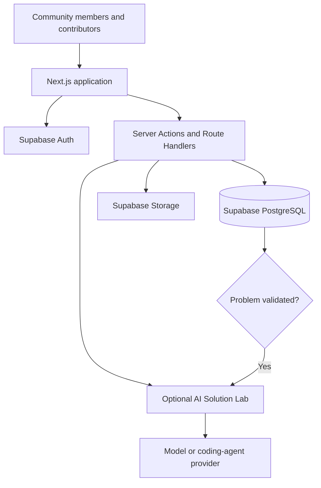

# ProblemSpot

<p align="center">
  
</p>

<p align="center">
  <strong>Real Community Problems. Together, Real Solutions.</strong><br />
  <em>Report It. Validate It. Solve It.</em>
</p>

<p align="center">
  <a href="https://github.com/geekinks/problemspot/blob/main/LICENSE"></a>
  <a href="https://hacktoberfest.com"></a>
  <a href="https://github.com/geekinks/problemspot/issues"></a>
  <a href="https://github.com/geekinks/problemspot/pulls"></a>
</p>

ProblemSpot is an open-source community problem discovery, validation,
and solution-building platform. It helps people report challenges affecting
their communities, enables others to confirm and support those reports, and
turns validated problems into open-source missions for developers,
researchers, volunteers, and organizations.

AI and coding agents have made creating software faster than ever. The harder
question is no longer only *can we build an app?* It is *which problems are
worth solving, who actually experiences them, and which solutions deserve
people's time?* ProblemSpot exists to answer those questions through community
evidence and human validation before solution work begins.

> **Core principle:** People define the problems. Communities validate the
> needs. Contributors build solutions in the open. AI may assist builders only
> after validation. Communities measure the impact.

- **Organization:** GeekInk Innovations Ltd
- **Initiative:** Hacktoberfest 2026 — AI for Everyone
- **Repository:** [`geekinks/problemspot`](https://github.com/geekinks/problemspot)
- **Primary Domain:** [`problemspot.tech`](https://problemspot.tech) *(Secured)*
- **Backup Mirror:** `problemspot.org` *(Reserved)*
- **Topics & Tags:** `hacktoberfest`, `agent`, `community`, `ai`, `open-source`, `problem-solving`

------------------------------------------------------------------------

## Table of contents

-   [Why ProblemSpot?](#why-problemspot)
-   [How it works](#how-it-works)
-   [Key features](#key-features)
-   [AI Solution Lab](#ai-solution-lab)
-   [Architecture](#architecture)
-   [Project documentation](#project-documentation)
-   [Technology stack](#technology-stack)
-   [Getting started](#getting-started)
-   [Environment variables](#environment-variables)
-   [Database and migrations](#database-and-migrations)
-   [Security and privacy](#security-and-privacy)
-   [Project status](#project-status)
-   [Roadmap](#roadmap)
-   [Contributing](#contributing)
-   [Community and support](#community-and-support)
-   [License](#license)

## Why ProblemSpot?

Many community challenges remain invisible, are reported in disconnected
places, or never reach people who have the skills to help. Meanwhile,
developers can struggle to find well-described problems where their work
can make a real difference.

ProblemSpot aims to bridge that gap by providing a shared workflow to:

1.  Document real-world challenges.
2.  Gather community confirmations, support, and evidence.
3.  Organize reports and identify potential duplicates.
4.  Connect problems with people willing to develop solutions.
5.  Track progress and document real-world outcomes.
6.  Recognize the people who report problems and help solve them.

ProblemSpot is designed for communities everywhere, including
underserved communities where access to technology and technical
resources may be limited.

## How it works

1.  **Report:** A community member submits a problem, its location, who
    is affected, and optional evidence.
2.  **Validate:** Other people confirm that they experience the problem,
    express support, or contribute evidence.
3.  **Review:** Community moderators examine evidence, resolve duplicates,
    and determine whether the problem meets published validation criteria.
4.  **Open a mission:** A validated problem becomes an open-source challenge
    with affected users, evidence, constraints, and success criteria.
5.  **Collaborate:** Developers, researchers, designers, volunteers, and
    partner organizations propose and build solutions together. The optional
    AI Solution Lab can assist contributors at this stage.
6.  **Implement:** Contributors document milestones, prototypes,
    repositories, and deployments.
7.  **Measure impact:** The community and reviewers assess outcomes and
    recognize meaningful contributions.

### Community confirmation is not the same as verification

ProblemSpot distinguishes between:

-   **Personal confirmation:** "I experience this too."
-   **Community support:** "I support addressing this problem."
-   **Evidence review:** Supporting material has been examined.
-   **Verification:** An authorized reviewer has determined that
    sufficient evidence supports the stated problem.

Vote totals are not, by themselves, proof that a claim is true. AI is not used
to validate, rank, approve, reject, or verify community problem reports.

## Key features

### Community problem reporting

-   Structured reports with titles, descriptions, categories, and
    locations.
-   Optional supporting photos, documents, and references.
-   Search, filtering, and problem status tracking.

### Community validation

-   Separate personal-confirmation and support votes.
-   Duplicate-vote protection enforced by the database.
-   Evidence contributions and review workflows.
-   Traceable status changes and moderation decisions.

### Transparent progress and participation

-   Followable problem pages and visible status history.
-   Updates when a report receives confirmation, evidence, review, or a
    solution proposal.
-   Human-managed categories, duplicate review, moderation, and validation.
-   Shareable problem pages that help reporters gather community support.

### Community Impact Profiles

-   Public or private profile options.
-   Problem submission and contribution history.
-   Solution collaboration and implementation history.
-   Recognition badges for meaningful contributions.
-   Optional GitHub profile linking.

### Solution collaboration

-   Propose multiple solutions for a single problem.
-   Link repositories, prototypes, demos, and documentation.
-   Track contributors and implementation milestones.
-   Record evidence and assessments of outcomes.
-   Use an optional AI Solution Lab after validation to prepare briefs, explore
    approaches, identify skills, and break work into open-source tasks.

## AI Solution Lab

ProblemSpot deliberately keeps AI out of problem reporting, community voting,
moderation, and validation. Those activities depend on people, evidence,
published criteria, and accountable human review.

After a problem is validated, contributors may open the optional AI Solution
Lab. The lab helps an open-source team turn a validated need into collaborative
work. It may:

-   Draft an editable solution brief from approved evidence.
-   Identify unanswered research questions and implementation constraints.
-   Suggest technical and non-technical approaches without selecting a winner.
-   Break an accepted approach into milestones, GitHub issues, and contributor
    roles.
-   Draft repository documentation, testing criteria, accessibility checks, and
    risk checklists.
-   Summarize feedback from solution testing for the contributor team.

AI output is always attributable, editable, and advisory. It cannot change the
problem's validation status, rewrite the original report, choose the accepted
solution, or claim that an implementation created impact. The entire platform,
including manual solution collaboration, must work when the AI service is
unavailable.

For each deployed model or coding-agent integration, document the exact model
and version, license or terms, runtime, data-sharing behavior, evaluation
methodology, and known limitations.

## Architecture

ProblemSpot is designed as a modular Next.js application backed by
Supabase. Supabase provides authentication, PostgreSQL, and file
storage. An optional, server-side Solution Lab adapter is available only to
authorized contributors working on validated problems.



### Database entities

The proposed data model includes:

-   `profiles`
-   `categories`
-   `problems`
-   `problem_votes`
-   `evidence`
-   `problem_status_history`
-   `problem_relations`
-   `solutions`
-   `solution_contributors`
-   `solution_milestones`
-   `impact_assessments`
-   `badges`
-   `badge_awards`
-   `solution_lab_runs` (optional)
-   `moderation_actions`
-   `notifications` (optional)

See [`docs/ARCHITECTURE.md`](docs/ARCHITECTURE.md) for the detailed
architecture, entity relationships, RLS policy intent, API boundaries,
and deployment plan.

## Project documentation

### Product and community

-   [Product requirements](docs/PRD.md)
-   [Application specification](docs/APPLICATION_SPEC.md)
-   [User flows](docs/USER_FLOWS.md)
-   [User journeys](docs/USER_JOURNEYS.md)
-   [Roadmap](ROADMAP.md)
-   [Code of Conduct](CODE_OF_CONDUCT.md)
-   [Governance](GOVERNANCE.md)
-   [Support](SUPPORT.md)
-   [Problem validation policy](docs/VALIDATION_POLICY.md)
-   [Moderation policy](docs/MODERATION_POLICY.md)
-   [Data and privacy guide](docs/DATA_AND_PRIVACY.md)

### Contributors and engineering

-   [Contributing guide](CONTRIBUTING.md)
-   [Contributor workstreams](docs/CONTRIBUTOR_WORKSTREAMS.md)
-   [Development setup](docs/DEVELOPMENT.md)
-   [Testing guide](docs/TESTING.md)
-   [Accessibility guide](docs/ACCESSIBILITY.md)
-   [Architecture](docs/ARCHITECTURE.md)
-   [Database guide](docs/DATABASE.md)
-   [API guide](docs/API.md)
-   [Deployment guide](docs/DEPLOYMENT.md)
-   [Architecture decision records](docs/adr/README.md)

### Open-source solutions

-   [Open-source mission guide](docs/OPEN_SOURCE_MISSION_GUIDE.md)
-   [AI Solution Lab policy](docs/SOLUTION_LAB_POLICY.md)
-   [Security policy](SECURITY.md)
-   [Changelog](CHANGELOG.md)

## Technology stack

  Layer                          Technology
  ------------------------------ ---------------------------------------------
  Web application                Next.js, React, TypeScript
  Styling                        Tailwind CSS
  UI components                  shadcn/ui
  Authentication                 Supabase Auth
  Database                       Supabase PostgreSQL
  File storage                   Supabase Storage
  Optional AI integration        Provider-independent Solution Lab adapter
  Coding collaboration           GitHub repositories, issues, and pull requests
  Testing                        Unit, integration, and end-to-end tests
  CI/CD                          GitHub Actions (planned)

Technology choices may evolve as the project is tested and developed.

## Getting started

> **Project status:** The Next.js app shell is available. Reporting,
> authentication, Supabase, and Solution Lab integrations are planned but are not
> required to run the landing page.

### Prerequisites

-   Node.js 20.9 or newer.
-   npm (or the package manager configured by the repository).
-   Git.
-   Optional for future features: an approved AI or coding-agent provider for
    the Solution Lab.

### 1. Clone the repository

``` bash
git clone https://github.com/geekinks/problemspot.git
cd problemspot
```

### 2. Install dependencies

``` bash
npm install
```

### 3. Configure environment variables

The landing page runs without environment variables. For future integrations,
create a local environment file:

``` bash
cp .env.example .env.local
```

Add the values for your development environment. Never commit
`.env.local`.

### 4. Configure Supabase when implementing integrated features

1.  Create a Supabase project.
2.  Copy the project URL and publishable key into `.env.local`.
3.  Apply the repository's database migrations when they are available.
4.  Enable and test Row Level Security (RLS) policies before exposing
    application tables.
5.  Configure Storage buckets and policies for avatars and evidence.

### 5. Start the development server

``` bash
npm run dev
```

Open <http://localhost:3000>.

Development checks: `npm run typecheck`, `npm run lint`, `npm run
format:check`, and `npm run build`. Use `npm run format` to apply formatting.
To add a shadcn/ui component, run `npx shadcn@latest add button` (or another
component name). Shared UI primitives belong in `components/ui`; reusable
layout belongs in `components/layout`; feature code belongs in `features`.
The directories for future routes and modules remain empty until those
features are implemented.

## Environment variables

Example `.env.example`:

``` dotenv
# Supabase — safe to expose in the browser when using the publishable key
NEXT_PUBLIC_SUPABASE_URL=
NEXT_PUBLIC_SUPABASE_PUBLISHABLE_KEY=

# Server-only secrets. Never expose these through NEXT_PUBLIC_* variables.
SUPABASE_SERVICE_ROLE_KEY=

# Optional server-side Solution Lab configuration
SOLUTION_LAB_PROVIDER=
SOLUTION_LAB_API_TOKEN=
```

Notes: - Use only the publishable/anon key in browser code, together
with RLS. - The service-role/secret key bypasses RLS and must remain
server-side. - Keep `SOLUTION_LAB_API_TOKEN` server-side. - Send only the
minimum approved problem context to a provider. - Do not expose an
unauthenticated model or agent endpoint to the public internet.

## Database and migrations

All database schema changes should be version-controlled in
`supabase/migrations/`. Avoid undocumented manual changes to production.

Recommended implementation order:

1.  Profiles and categories.
2.  Problems and status history.
3.  Votes and database uniqueness constraints.
4.  Evidence and Storage policies.
5.  Solutions, contributors, milestones, and impact assessments.
6.  Badges and recognition.
7.  Moderation records and notifications.
8.  Optional Solution Lab runs for validated problems.

Test RLS as different user roles, including unauthenticated users,
regular users, submitters, and moderators. Do not rely on frontend
checks alone.

## Security and privacy

ProblemSpot handles user-generated reports and potentially sensitive
community information. Security and privacy are core requirements.

-   Enable RLS on all tables exposed through Supabase APIs.
-   Enforce permissions in the database and trusted server-side code.
-   Never commit secrets or place service-role credentials in
    client-side bundles.
-   Keep sensitive evidence in private Storage buckets.
-   Validate uploaded files, sizes, and content types.
-   Avoid collecting unnecessary personal information or precise
    locations.
-   Provide anonymous public attribution where appropriate without
    bypassing moderation.
-   Rate-limit submissions, votes, uploads, and Solution Lab requests.
-   Keep Solution Lab output separate from original reports and reviewed
    evidence.
-   Record moderation and verification decisions.
-   Publish privacy, moderation, and security-reporting policies before
    public launch.

For vulnerability reports, follow the instructions in
[`SECURITY.md`](SECURITY.md) when available. Please do not publish
exploitable security details in public issues.

## Project status

ProblemSpot is in the planning and early development stage. The
architecture and feature descriptions in this README describe intended
functionality and should not be interpreted as confirmation that every
feature is already implemented.

Contributions are welcome as the MVP takes shape. Issues and pull
requests should clearly distinguish implemented functionality from
proposals.

## Roadmap

-   [ ] Initialize the Next.js application and Supabase project.
-   [ ] Add authentication and community profiles.
-   [ ] Implement problem submission and discovery.
-   [ ] Implement community confirmation and support voting.
-   [ ] Add validation status history and moderation.
-   [ ] Add evidence uploads with private Storage policies.
-   [ ] Add human-managed categories and duplicate-review workflows.
-   [ ] Add solution proposals and contributor attribution.
-   [ ] Add GitHub-linked open-source challenge workspaces.
-   [ ] Add the optional AI Solution Lab for validated problems.
-   [ ] Add Community Impact Profiles and recognition badges.
-   [ ] Track implementation milestones and impact assessments.
-   [ ] Add automated tests, CI, and deployment documentation.
-   [ ] Run a community pilot and publish evaluation results.

## Contributing

We welcome contributions from developers, designers, researchers,
writers, community organizers, and people who understand local
challenges.

Potential contribution areas: - Frontend and accessibility. - Backend
and Supabase database design. - RLS policies and security testing. - Solution
Lab and coding-agent integration. - Documentation and tutorials. - Hausa and
other language support. - Community research and user testing. - Moderation,
validation, and open-source collaboration workflows.

Before contributing:

1.  Read [`CONTRIBUTING.md`](CONTRIBUTING.md).
2.  Check existing issues and discussions.
3.  Start with a clearly scoped issue.
4.  Include tests for behavior changes.
5.  Never submit secrets, private personal information, or sensitive
    evidence.
6.  Explain the problem your change solves and how it was tested.

For Solution Lab contributions, include model or agent details, licensing and
data-sharing information, evaluation methods, safeguards, and known
limitations. The integration must enforce the validated-problem gate.

## Community and support

ProblemSpot is an initiative associated with **GeekInk Innovations Ltd**
and the Hacktoberfest 2026 theme **AI for Everyone**.

Use [GitHub Discussions](https://github.com/geekinks/problemspot/discussions)
for questions and community conversation. See [SUPPORT.md](SUPPORT.md) for the
correct bug, feature, community-use-case, and private security channels. All
participants must follow [CODE_OF_CONDUCT.md](CODE_OF_CONDUCT.md).

Please be respectful and constructive. Contributors should receive
credit for both identifying important problems and helping implement
solutions.

## License

Choose and add an approved open-source license before the first public
release. MIT and Apache-2.0 are permissive options; GPL-3.0 is a
copyleft option. The maintainers should select the license that fits the
project's goals and add the full license text in `LICENSE`.

The application license does not automatically apply to third-party
models, coding agents, datasets, user-submitted evidence, or other external assets.
Document their respective terms separately.

------------------------------------------------------------------------

**ProblemSpot --- Report It. Validate It. Solve It.**
