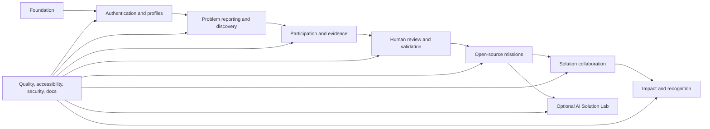

# Contributor Workstreams

This document converts the application specification into contribution areas.
Create linked GitHub epics and small issues rather than implementing an entire
workstream in one pull request.

## Dependency map

## Workstreams

| ID | Workstream | Deliverable | Depends on |
|---|---|---|---|
| W0 | Foundation | CI, environment validation, shared UI, error conventions. | None |
| W1 | Auth and profiles | Secure accounts, visibility, settings, and contribution profile shell. | W0 |
| W2 | Reporting and discovery | Submit, search, filter, and read problems. | W0, W1 |
| W3 | Participation and evidence | Confirm, support, follow, upload, and notify. | W1, W2 |
| W4 | Human review | Review queue, status history, duplicates, disputes, and appeals. | W2, W3 |
| W5 | Open-source missions | Verified handoff, mission directory, context, and steward roles. | W4 |
| W6 | Solution collaboration | Proposals, teams, repositories, milestones, and testing feedback. | W5 |
| W7 | Impact and recognition | Outcome levels, evidence, attribution, and profiles. | W6 |
| W8 | Optional Solution Lab | Verified gate, provider adapter, audited tasks, and manual fallback. | W5 |
| W9 | Quality and operations | Accessibility, security, testing, privacy, deployment, and observability. | Continuous |

## How to split an epic

Each vertical feature usually needs separate, linked issues for:

1. Product copy and acceptance criteria.
2. Database migration, constraints, indexes, and RLS.
3. Server schema, authorization, and operation.
4. Accessible UI including loading, empty, error, and permission states.
5. Unit, database, integration, and end-to-end tests.
6. Documentation, screenshots, and migration or deployment notes.

Keep a pull request focused. Avoid combining schema, an entire dashboard,
provider integration, and unrelated refactors.

## Contribution-ready issue checklist

An issue is ready when it includes:

- The user or community problem.
- Scope and explicit non-goals.
- Relevant flow and journey links.
- Acceptance criteria.
- Authorization and visibility rules.
- Privacy and accessibility considerations.
- Dependencies and affected modules.
- Expected tests and documentation.
- Appropriate difficulty and skill labels.

## Suggested labels

### Area

`area:auth`, `area:reporting`, `area:validation`, `area:missions`,
`area:solutions`, `area:impact`, `area:solution-lab`, `area:docs`

### Discipline

`frontend`, `backend`, `database`, `design`, `accessibility`, `security`,
`testing`, `research`, `documentation`

### Contributor fit

`good first issue`, `help wanted`, `needs mentor`, `advanced`

### State

`needs discovery`, `ready`, `blocked`, `in progress`, `needs review`

Do not use `good first issue` for work involving production secrets, complex
RLS, sensitive evidence, validation authority, or autonomous agent permissions.

## Example issue slices

### Good first issue

**Add an accessible empty state to the mission directory**

- Explain what a mission is.
- Link to verified problems when none match the filters.
- Support keyboard navigation and responsive layout.
- Add component tests or documented manual checks.

### Intermediate issue

**Add separate confirmation and support controls**

- Implement distinct labels and selected states.
- Handle authentication and duplicate responses.
- Preserve focus and announce count updates.
- Add server and database tests.

### Advanced issue

**Enforce the Solution Lab verification gate**

- Load authoritative problem status server-side.
- Authorize requester and every source.
- Reject unverified or restricted contexts without leaking data.
- Create an auditable run only after all checks pass.
- Add bypass, concurrency, and provider-failure tests.

## Contributor starting path

1. Read [APPLICATION_SPEC.md](APPLICATION_SPEC.md).
2. Choose one flow in [USER_FLOWS.md](USER_FLOWS.md).
3. Read the related persona journey in [USER_JOURNEYS.md](USER_JOURNEYS.md).
4. Select an issue from the earliest unblocked workstream.
5. Follow [DEVELOPMENT.md](DEVELOPMENT.md) and [TESTING.md](TESTING.md).
6. Open a focused pull request with evidence against the acceptance criteria.

