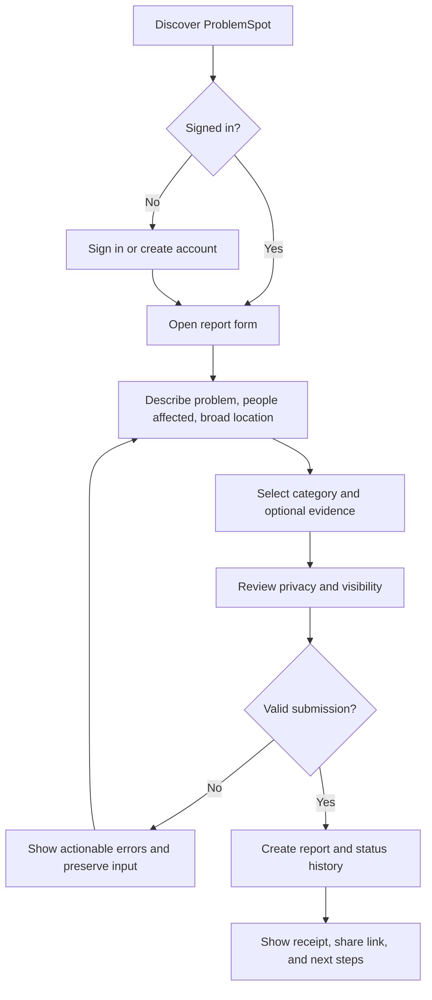
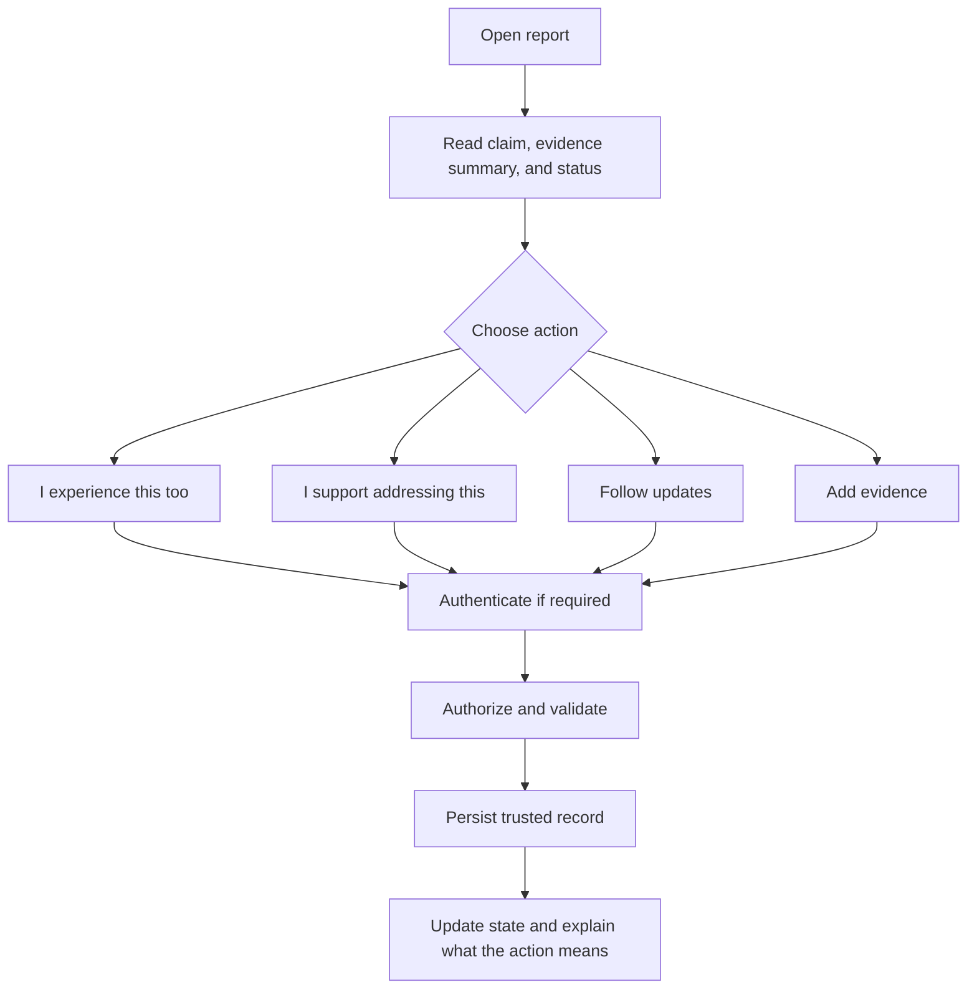
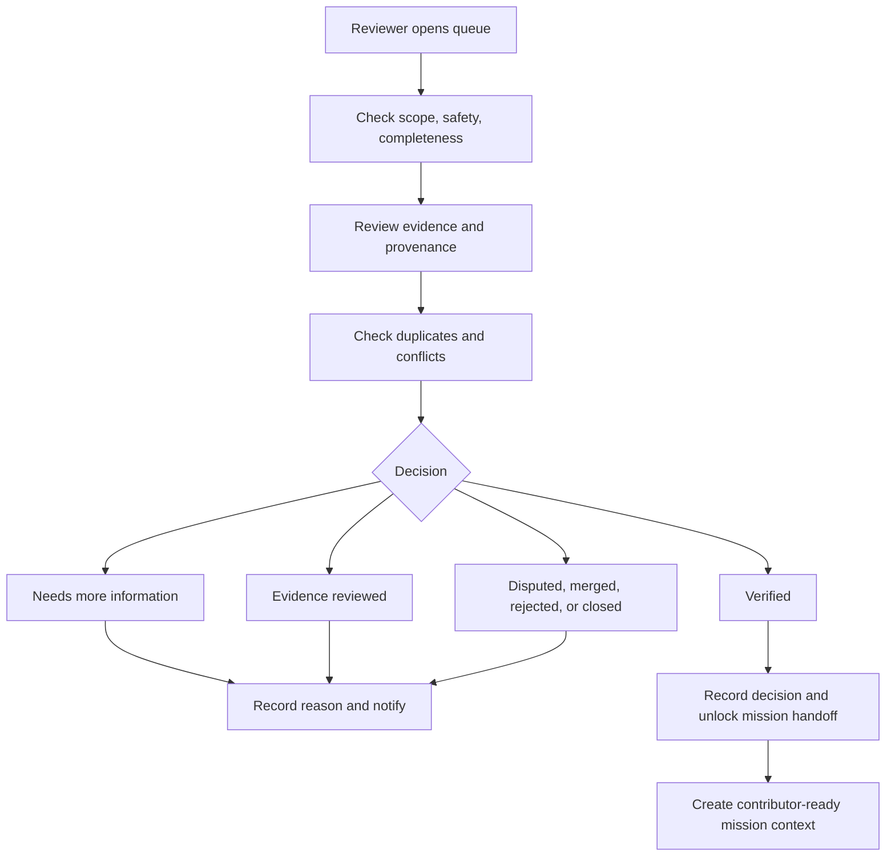
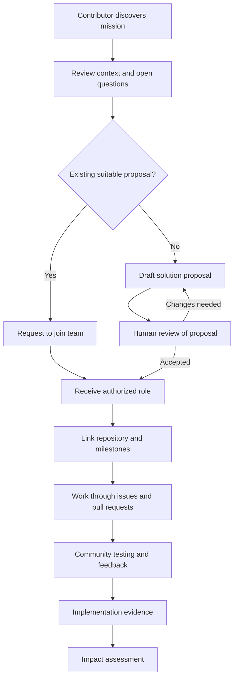
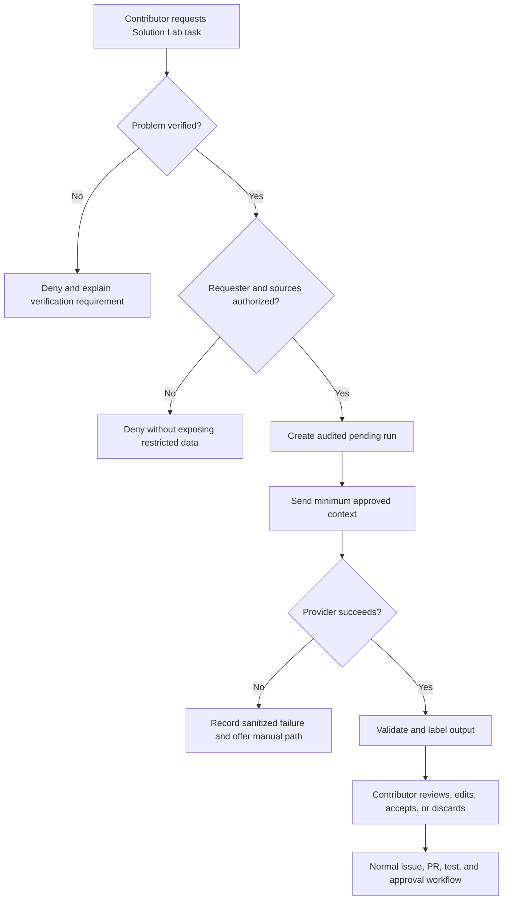
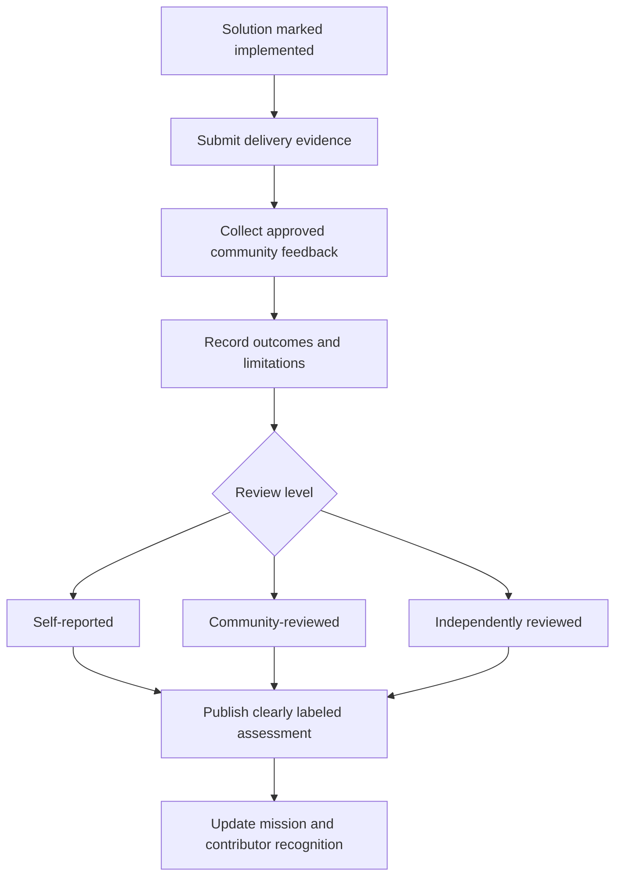

# ProblemSpot User Flows

These flows define expected behaviour and edge cases. They are suitable for
splitting into UI, API, database, test, accessibility, and documentation issues.

## Flow 1: Report a problem

**Completion:** the user receives a stable report link and can track progress.

**Important edges:** unsafe evidence, duplicate-looking reports, restricted
location, upload failure, expired session, rate limit, and anonymous public
attribution.

## Flow 2: Confirm, support, follow, or add evidence

**Completion:** the user's action is visible and reversible where policy allows.

**Important edges:** duplicate request, withdrawn vote, private evidence,
unsupported file, concurrent updates, and suspended account.

## Flow 3: Human review and validation

**Completion:** an auditable human decision exists. Only `verified` unlocks the
mission and Solution Lab gate.

**Important edges:** reviewer conflict, insufficient evidence, high-risk
allegation, restricted material, appeal, and merge attribution.

## Flow 4: Build an open-source solution

**Completion:** solution progress, contributors, decisions, evidence, and
limitations are visible at the appropriate access level.

**Important edges:** competing proposals, inactive team, unsafe approach,
repository permission failure, withdrawn solution, and failed community test.

## Flow 5: Use the optional AI Solution Lab

**Completion:** a reviewed artifact may enter ordinary collaboration; generated
output never becomes an automatic decision.

## Flow 6: Assess impact

**Completion:** users can distinguish delivery from impact and see who reviewed
the claim.

## Cross-flow requirements

- Authentication does not erase the user's intended destination.
- Unauthorized responses do not reveal whether restricted data exists.
- Every consequential action has a reason, actor, and timestamp.
- Notifications link to the relevant state and respect privacy.
- Keyboard and screen-reader users can complete every flow.
- Provider, storage, or notification failure does not corrupt core records.

